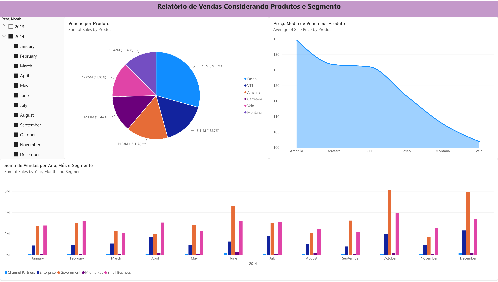
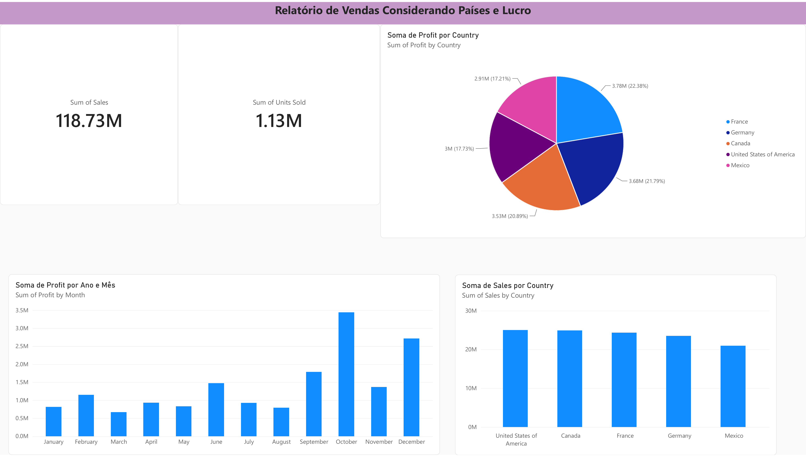
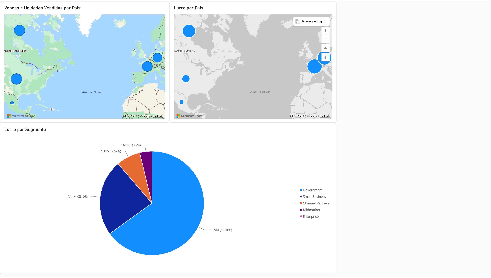

# Power BI | Financial Sample

Projeto prático da trilha **Primeiros Passos em Power BI** (DIO). O desafio consiste em replicar duas páginas de relatório construídas durante o curso e criar uma terceira página, de autoria própria, treinando a criação e a configuração de visuais.

## Objetivos

- Replicar as duas páginas de relatório apresentadas nas aulas, usando a base *Financial Sample*.
- Criar uma terceira página com mapas e gráfico de pizza.
- Dar nomes claros aos visuais e configurar os campos das dicas de ferramenta.
- Organizar a disposição dos visuais no relatório.
- Exportar o relatório para PowerPoint e PDF e versionar tudo no GitHub.

## Base de dados

A base utilizada é o **Financial Sample**, disponibilizada no repositório do curso ([julianazanelatto/power_bi_analyst](https://github.com/julianazanelatto/power_bi_analyst), pasta `dataset`). O arquivo está nesta pasta: [`dataset/Financial Sample.xlsx`](dataset/Financial%20Sample.xlsx).

Principais colunas usadas: `Segment`, `Country`, `Product`, `Units Sold`, `Sale Price`, `Sales`, `Profit` e `Date`.

Tratamento feito no Power Query: a coluna de vendas veio com um espaço no início do nome (`" Sales"`) e foi renomeada para `Sales`. Os tipos de dados foram conferidos (texto para `Segment`, `Country` e `Product`; números para `Units Sold`, `Sales` e `Profit`; data para `Date`).

## Páginas do relatório

### Página 1: Produtos e Segmento (réplica da aula)



- Título do relatório em caixa de texto.
- Segmentação de dados por **Ano e Mês** (hierarquia de `Date`).
- **Pizza:** vendas (soma de `Sales`) por `Product`.
- **Gráfico de área:** preço médio de venda (média de `Sale Price`) por `Product`.
- **Colunas agrupadas:** soma de `Sales` por ano, mês e `Segment`.

### Página 2: Países e Lucro (réplica da aula)



- Título do relatório em caixa de texto.
- **Cartões:** soma de `Sales` e soma de `Units Sold`.
- **Pizza:** soma de `Profit` por `Country`.
- **Colunas:** soma de `Profit` por mês.
- **Colunas:** soma de `Sales` por `Country`.

### Página 3: Mapas e Lucro (criada de forma autônoma)



| Visual | Tipo | Campos |
|---|---|---|
| Vendas e Unidades Vendidas por País | Azure Maps | Localização: `Country` · Tamanho: soma de `Sales` · Dicas de ferramenta: soma de `Units Sold` |
| Lucro por País | Azure Maps | Localização: `Country` · Tamanho: soma de `Profit` · Dicas de ferramenta: `Sales` e `Units Sold` |
| Lucro por Segmento | Pizza | Legenda: `Segment` · Valores: soma de `Profit` · Dicas de ferramenta: `Sales` |

Pontos trabalhados nesta página:

- **Disposição:** mapas lado a lado na parte de cima e pizza abaixo, sem sobreposição.
- **Nomes dos visuais:** títulos curtos e diretos, em português.
- **Dicas de ferramenta:** campos complementares ao que está na tela, para aprofundar a leitura ao passar o mouse.

## Ferramentas

- **Power BI Service** (versão web), com Power Query online para a transformação dos dados.
- Exportação do relatório para **PowerPoint** e **PDF**.
- **Git/GitHub** para versionamento e portfólio.

> **Observação:** o relatório foi construído no Power BI Service, pelo navegador, porque o Power BI Desktop é exclusivo do Windows e o ambiente de desenvolvimento usado é Linux (Debian). Por isso o projeto é entregue em PowerPoint e PDF, em vez de um arquivo `.pbix`.

## Estrutura do repositório

```
power-bi-financial-sample/
├── README.md
├── dataset/
│   └── Financial Sample.xlsx
├── relatorio/
│   ├── Desafio_Power_BI-Financial_Sample.pptx
│   └── Desafio_Power_BI-Financial_Sample.pdf
└── imagens/
    ├── pagina1-produtos-segmento.png
    ├── pagina2-paises-lucro.png
    └── pagina3-mapas-lucro.png
```

## Aprendizados

- Fluxo do Power BI: obter dados, transformar no Power Query, modelar e visualizar.
- Diferença entre ETL e ELT e onde o Power BI se encaixa nessas etapas.
- Uso da hierarquia de datas (ano e mês) em segmentações e gráficos.
- Escolha do tipo de visual e configuração de campos, títulos e dicas de ferramenta.
- Cuidados com a qualidade dos dados, como nomes de colunas com espaços indesejados.

## Autora

**Vania Maria Batista**

- GitHub: [vaniamariabatista-cyber](https://github.com/vaniamariabatista-cyber)
- LinkedIn: [vania-batista-869589323](https://www.linkedin.com/in/vania-batista-869589323)

Projeto desenvolvido como parte da trilha de Power BI da [DIO](https://www.dio.me).
